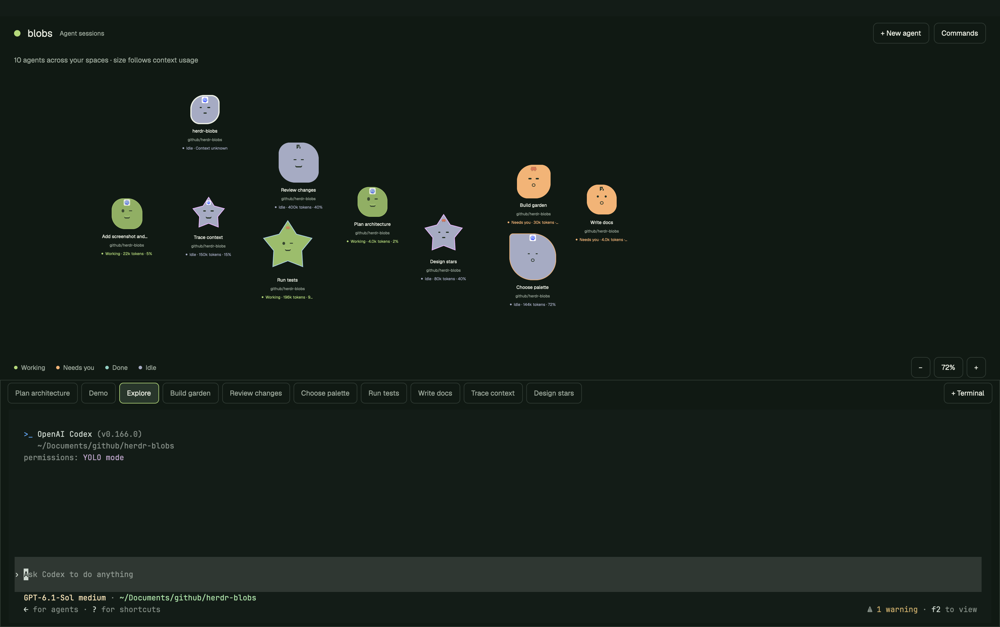

# Blobs for Herdr

The Blobs layout shows each agent as a blob above its terminal. Size shows context usage; color shows whether the agent is working, blocked, done, or idle. Each address keeps its face and blob type across reloads.



## Use

Click a blob to open its session in the bottom terminal. Hover to see its name, state, and context usage. Labels show the working directory. Agents without context counters show "Context unknown".

Drag a blob to move it. Scroll to zoom around the cursor from 10% to 400%. Drag the background or Shift-scroll to pan. The − and + buttons zoom around the viewport center; click the percentage to reset the view to fit. Pan to reach blobs outside the viewport.

Right-drag a box to select blobs. Hold Shift to add to the selection. Right-click a selected blob or the background for group actions. Right-click an unselected blob to select it and show its actions. Kill selected asks for confirmation before ending the selected agents and their sub-agents.

Blobs bob and blink. Working blobs bob faster; idle blobs have sleepy eyes. Labels stay steady. Bobbing pauses while you drag, pan, or select.

## Start agents and terminals

`+ New agent` opens the launcher. Choose an installed agent, permission mode, working folder, optional model, and optional first task. Starting an agent opens and selects a new tab immediately. Its blob appears beside the last active blob in the nearest free slot. Existing blobs keep their positions.

The launcher remembers the last selected agent, even if you cancel. If that agent is unavailable, it selects the first installed agent. It also remembers each agent's last launched permission mode and model.

Codex offers Default, Read only, Workspace auto, and YOLO. Claude offers Default, Plan, Accept edits, and YOLO. Default preserves your existing agent configuration. YOLO bypasses approval checks; Codex YOLO also disables its sandbox. The launcher remembers YOLO. Choose another mode before starting if you want different permissions.

`+ Terminal` opens a shell in a new tab. Use the tab strip to switch sessions. Commands opens the palette. Drag the divider above the session to resize it. Existing keyboard bindings stay in place; `ctrl-shift-l` switches layouts.

## Install

Requires Herdr with native mods and active-tab terminal blocks. Context counters also require Python 3 on the agent's machine.

Copy `mods/blob-garden/`, `mods/blob-tabs/`, and `mods/blob-launcher/` into `~/.config/herdr-app/mods/`. Copy both files from `layouts/` into `~/.config/herdr-app/layouts/`. Copy only source and assets. If a name already exists, rename the incoming layout or mod and update its references first.

```sh
herdr-app check ~/.config/herdr-app/mods/blob-garden
herdr-app check ~/.config/herdr-app/mods/blob-tabs
herdr-app check ~/.config/herdr-app/mods/blob-launcher
herdr-app do layout.switch '{"name":"blobs"}'
herdr-app status
```

## Context usage and blob types

The garden checks Codex context counters every 10 seconds. A Python helper reads Codex's local state database and token-count records on each agent's machine. It returns counters, not session messages. The mods make no network requests. The launcher detects installed agents and starts programs through Herdr.

Blob size follows the fraction of context in use. Diameter ranges from 81px to 144px before fitting and zoom. Unknown context uses the minimum size. Dragged positions and pan stay in mod-local storage.

Each agent address determines a blob type. Common types are Pebble at 30%, Sprout at 28%, and Ripple at 27%. Rare types are Ember and Frost at 7% each. Cosmic is ultra rare at 1%. Pebble, Sprout, Ripple, and Ember have rounded shapes; Frost and Cosmic are five-point stars. Each blob has its agent program's logo on its forehead. Rare types have a colored outline. Body color shows agent state.

## Demo

Run `python3 demo/workspace.py` while Herdr is open. It creates eight scripted sessions spread across the garden, with all six blob types, varied context usage, and 60% garden zoom. It runs no AI agents or API calls. Close the Blobs demo space when finished.

To show real coding terminals, run `python3 demo/workspace.py --live --count 6`. It launches six interactive Codex agents with the configured model and a read-only sandbox. Each reads the repository and reports on its named task. Live mode uses your Codex account. Status comes from the agents; blob type, context usage, and positions use demo overrides. Agents stay open for follow-up input.

Export demo settings with `python3 demo/workspace.py --dry-run`. Edit the JSON and pass it with `--config <file>`. The [demo-blobs skill](.agents/skills/demo-blobs/SKILL.md) covers setup, verification, and changes to an open demo.

## Development

Run regression tests:

```sh
node --test tests/*.test.mjs
python3 -m unittest discover -s tests -p '*_test.py'
```

