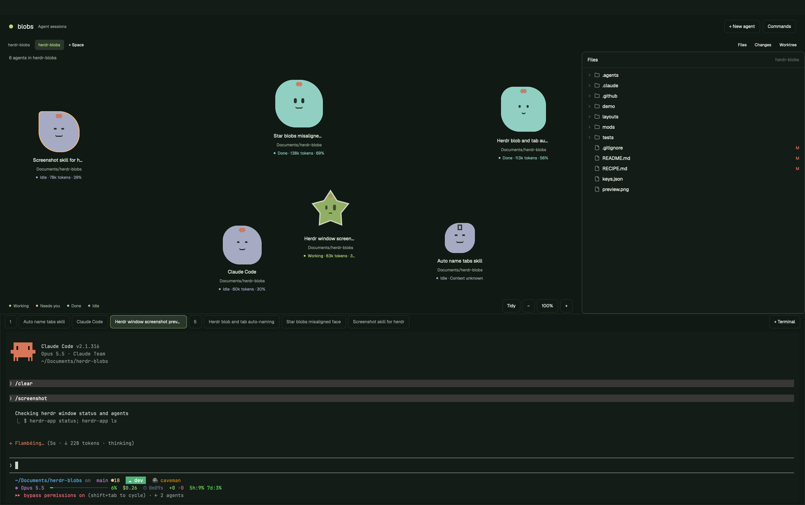

# Blobs for Herdr

The Blobs layout shows each agent as a blob above its terminal. Size shows context usage; color shows whether the agent is working, blocked, done, or idle. Each address keeps its face and blob type across reloads.



## Use

Click a blob to open its session in the bottom terminal. Hover to see its name, state, and context usage. Labels show the working directory. Agents without context counters show "Context unknown".

Drag a blob to move it. Scroll to zoom around the cursor from 10% to 400%. Drag the background or Shift-scroll to pan. The − and + buttons zoom around the viewport center; click the percentage to reset the view to fit. Pan to reach blobs outside the viewport.

Sub-agents appear as blobs tied to the blob that spawned them. They spawn beside their parent, a line joins the two, and dragging the parent brings its sub-agents along.

Right-drag a box to select blobs. Hold Shift to add to the selection. Right-click a selected blob or the background for group actions. Right-click an unselected blob to select it and show its actions. Kill selected asks for confirmation before ending the selected agents and their sub-agents.

Blobs bob and blink. Working blobs bob faster; idle blobs have sleepy eyes. Labels stay steady. Bobbing pauses while you drag, pan, or select.

## Workspace

The space strip switches between repositories and worktrees. The garden shows only the active space's agents, and each space keeps its own pan and zoom. Tidy gathers the active space's blobs and leaves other spaces' positions alone. `+ Space` picks a folder and opens it as a new space. Right-click a space to remove it; a confirmation dialog warns that its sessions end. `Worktree` shows New, Open, and Remove, which open Herdr's worktree dialogs to create a branch checkout with its own space, switch to an existing checkout, or remove one.

Workspace controls sit above the blobs. `Files` and `Changes` toggle panels beside them. Right-click a file in Files and choose Open in editor to open it in its default app. The bottom section contains session tabs and the active terminal.

Merge the `layout:blobs` bindings from [keys.json](keys.json) into your Herdr keys for shortcuts. Ctrl+Shift+S opens Shell, and Ctrl+Shift+F/G toggle Files/Changes. Alt+Up/Down switch spaces; Alt+Shift+Up/Down switch agents.

## Start agents and terminals

`+ New agent` opens the launcher. Choose an installed agent, permission mode, working folder, optional model, and optional first task. Starting an agent opens and selects a new tab immediately. Its blob appears beside the last active blob in the nearest free slot. Existing blobs keep their positions.

The launcher remembers the last selected agent, even if you cancel. If that agent is unavailable, it selects the first installed agent. It also remembers each agent's last launched permission mode and model.

Codex offers Default, Read only, Workspace auto, and YOLO. Claude offers Default, Plan, Accept edits, and YOLO. Default preserves your existing agent configuration. YOLO bypasses approval checks; Codex YOLO also disables its sandbox. The launcher remembers YOLO. Choose another mode before starting if you want different permissions.

`+ Terminal` opens a shell in a new tab. Use the tab strip to switch sessions. Commands opens the palette. Drag the divider above the session to resize it. Existing keyboard bindings stay in place; `ctrl-shift-l` switches layouts.

## Install

Open [Herdr](https://herdr.dev/) and tell your agent:

```text
Read ~/.config/herdr-app/AGENTS.md, then install and switch to the Blobs layout from https://github.com/scott-the-programmer/herdr-blobs. Read the repository files before installing, merge its layout-specific keys, and preserve my existing layouts, mods, and keybindings.
```

## Tests

Run regression tests:

```sh
node --test tests/*.test.mjs
```
