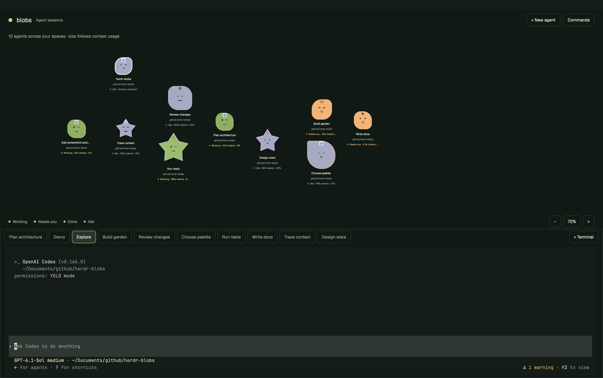

# Blobs

A dark green Herdr window shows each live agent as a blob with a face. Blobs drift in a compact group. Size shows context usage; color shows agent state. Click a circle to switch the bottom terminal to that session. New agent opens a launcher with permission modes, folder, model, and first task; starting one opens and selects a new tab immediately.



## What you see

- A 58px header on `#101913` contains a green dot, "blobs", the subtitle "Agent sessions", and New agent and Commands buttons. Keep the system title bar.
- The garden fills the upper region with 24px horizontal padding. A 65px heading shows "Agent sessions" at 24px and the live agent count when there are zero or one agents. Above one agent, hide that title and reduce the heading to 34px, retaining the count. A 42px footer shows the four status colors and names. Use Geist, `#edf0e5` primary text, and `#9da99c` secondary text.
- Between heading and legend, circles form a compact group with slow orbital drift. Fit every circle and label inside the measured field, scaling the group down when needed. Each has equal width and height, a round outline, and two dark eyes over a mouth. Circles start at 81px diameter and grow to 144px. Labels underneath show the agent name at 13px, the last two working-directory components at 11px, and state and context usage at 11px. Long labels truncate. Hover shows the name capped at 40 characters, then state and context usage.
- A draggable divider separates the garden from the bottom session region. Both initially have equal weight. Garden minimum height is 220px; session minimum is 180px. The garden fits every circle and its label inside its current bounds.
- A 44px tab strip heads the session. It scrolls horizontally and shows every tab in the active space. The selected tab has a green border. A fixed + Terminal button sits on the right. Below it are the active tab's real terminals, using JetBrains Mono 13px, `#131c17` background, `#edf0e5` text, and padding of 6px vertically and 14px horizontally.
- New agent opens a centered 600 by 660px dark dialog. It has installed-agent choices, permission mode buttons and explanation, folder with local Browse button, optional model and first-task fields, Cancel, and Start agent. YOLO changes the explanation to orange and the start button to "Start in YOLO mode". Model appears only for Codex and Claude. Loading, missing-agent, and error messages occupy the agent section as needed.

## How it behaves

| State | Circle color | Face and motion |
| --- | --- | --- |
| working | `#b5d97b` | Open eyes; opacity breathes from 0.78 to 1. |
| blocked | `#f2b477` | "Needs you" label, open mouth. |
| done | `#92cfc3` | "Done" label, ordinary face. Herdr turns done into idle once viewed. |
| idle | `#a6abc3` | "Idle" label, short closed eyes. |

Focused and box-selected blobs have a 3px off-white outline. Hover dims the body and shows only a short name, state, and context summary. Clicking the body focuses its session. Right-drag selects multiple bodies; Shift adds to selection. Right-click opens actions for the selection, replacing it only when clicking an unselected body. Kill selected opens a centered confirmation dialog. Confirming runs `terminal.kill {terminal: address}` once per captured address, ending those agents and their sub-agents. Cancel, Escape, or dismissing the dialog leaves them running. Descendants without panes appear too, marked Sub-agent, and open in their parent's tab when clicked. Labels themselves are informational.

Tab clicks select that tab. + Terminal opens and selects a fresh shell tab. New agent first detects programs installed on the current space's machine. Pick an agent, mode, folder, optional model, and optional task, then press Start agent. The new tab becomes visible immediately, before status arrives. A new circle appears when the program reports status. With no space, the launcher creates a new space instead. Commands opens Herdr's palette. Existing key bindings remain intact; agent navigation follows displayed agent addresses.

Default permission mode uses the configured launch command unchanged. Codex also offers Read only, Workspace auto, and YOLO. Claude offers Plan, Accept edits, and YOLO. Other executable names get Default only. Selecting another agent or reopening the launcher restores that agent's last launched permission mode and model, including YOLO. Agents without saved options use Default and an empty model. YOLO bypasses permission checks; Codex YOLO also disables its sandbox. Launch only when the user presses Start agent or submits the task field.

Folder defaults to the focused terminal's current directory, then the space folder. Browse is local-only; remote paths can be typed. Empty model and task fields keep agent defaults and start without an initial task.

Poll Codex context counters every 10 seconds through `context.py`, using Python 3 on the terminal's machine. Match sessions by explicit thread or session label, or by a unique directory and title match in Codex's state database. Scan at most the last 8 MiB of the session log for a token-count record. Return only counters. If no unique match or valid counter exists, show "Context unknown" and use the minimum blob size. Body diameter updates immediately so camera zoom keeps bodies, faces, and labels in sync.

Working opacity runs natively with a period of 2400ms plus 160ms per list position. Circles drift through native position loops while faces and labels stay upright. Reserve their entire motion envelopes so neighboring paths do not collide or leave the field.

When no agents report status, show "No agents yet", a status-reporting explanation, and New agent. Ordinary shell tabs remain usable in the bottom region and get no circles.

## Built from

Create the following files in an empty folder, with no package installation or build step:

```text
layouts/blobs.json
layouts/blobs.png
mods/blob-garden/mod.json
mods/blob-garden/main.js
mods/blob-garden/geometry.js
mods/blob-garden/types.js
mods/blob-garden/context.js
mods/blob-garden/context.py
mods/blob-garden/demo.js
mods/blob-garden/positions.js
mods/blob-tabs/mod.json
mods/blob-tabs/main.js
mods/blob-launcher/mod.json
mods/blob-launcher/main.js
mods/blob-launcher/options.js
README.md
RECIPE.md
preview.png
tests/launcher.test.mjs
tests/geometry.test.mjs
tests/types.test.mjs
tests/context.test.mjs
tests/context_reader_test.py
tests/demo.test.mjs
tests/demo_workspace_test.py
tests/positions.test.mjs
tests/garden.test.mjs
demo/workspace.py
```

Use this layout tree, a moss root theme, Geist UI font, JetBrains Mono terminal font, and the explicit colors above:

```text
root: column, background #101913, system title bar
  garden-header: block, 58px, blob-garden {role: "header"}
  garden-board: block, weight 1, min 220px, blob-garden {role: "board"}
  session: column, weight 1, min 180px, 1px #303b34 border
    session-label: block, 44px, blob-tabs
    session-terminal: block, {tab: "active"}, padding [6, 14]
```

The preview path is `layouts/blobs.png`, copied from the actual window screenshot `preview.png`. Each manifest uses `place: "none"`. The launcher manifest sets overlay width 600 and height 660. Keep the shipped mods separate from the layout. Herdr still provides its palette, notifications, and native terminal renderer.

All mods default-export a native `View`. Use `div` from `gpui-kit` and `h_flex`/`v_flex` from `gpui-base`. The launcher also uses `InputState` and `Input`.

Art uses native rounded rectangles and vector paths for five-point stars. There are no bitmap art dependencies or custom fonts.

The board reads `agents()`, `terminals()`, and `focused()`. Begin with agents in pane order. Recursively append live terminals with a known parent and a reported status. Inherit their parent's space name, map error to blocked, and normalize unknown states to idle. Exclude unrelated core terminals. Call `setAgentOrder` on board render. Circle clicks call `agent.focus {terminal}` and `pane.focus {terminal}`; descendants also call `terminal.show {terminal}`. Active-tab content handles the selected agent's parent tab.

The legacy terminal-label role is unused by this layout.

Keep geometry in a pure `arrange` helper. Measure the actual field's width and height with `on_size_change` and notify only for changes greater than 1px. Reserve base cells 160px wide and 256px high, 8px gaps, and orbit margins of 14px horizontally and 10px vertically. Try each possible column count, compute rows with a ceiling, and maximize a uniform scale capped at 1 so the complete cells and their motion envelopes fit. Break scale ties by choosing a compact group shape.

Sort addresses by a stable FNV-style hash, center each row, and use at most 4px of seeded positional variation. Status changes leave positions stable; count and available bounds can change the arrangement. The initial arrangement fits inside the field. Dragged pins and new blobs beside an existing blob may extend beyond it; use pan to reach them.

Each cell uses native left and top animation loops. Horizontal motion spans center plus or minus 14px at scale 1, over 45 to 57 seconds. Vertical motion spans plus or minus 10px, over 60 to 72 seconds. Seed periods by address. Their different periods create orbital drift. Scale position ranges with the cells, give each cell a stable orbit ID, and keep all text and faces upright.

Add −, percentage, and + controls beside the legend. Adjust zoom from 10% to 400%; clicking the percentage resets to 100% and clears pan, fitting the group. Fit the world layout independently of zoom, apply normalized pins there, then scale positions, cells, labels, and orbit paths together around the viewport center and add pan. Scroll zooms smoothly around the cursor, preserving the world point beneath it. Buttons zoom around the viewport center in 10 percentage point steps. Drag the background or Shift-scroll to pan. Clip the fixed viewport without native scrollbars; convert blob drags through the inverse camera transform. Zoom starts at 100% when the board loads.

Diameter is `sqrt(81 ** 2 + (144 ** 2 - 81 ** 2) * ratio) * scale`, where `ratio` is context tokens used divided by the context limit, clamped to 0 through 1. Scale the label sizes, gaps, face parts, and borders with the cell. Give the body equal width and height, `flex_none()`, and radius half its diameter so flex layout cannot flatten it.

Choose one of six face styles by a stable hash of the agent address. Vary eye widths, heights and spacing, including a wink and uneven eyes, with smiling, flat or open mouths. Idle eyes flatten to at most 3px; blocked mouths become small open ovals; done mouths smile. Face color is `#263325`. Scale every face part with the blob; draw smiles and open mouths with native rounded rectangles. Update context-sized dimensions immediately and use native opacity loops.

Only the board starts the 10-second context timer. Store dragged pins under mod-local key `positions-v1` and pan under `canvas-pan-v1`. Recover from corrupt JSON and use each callback's own `cx`.

The tab mod reads `spaces()`, lists the active space's tabs, calls `tab.select {id}` for each tab, and `tab.new {space}` for + Terminal. The bottom terminal block must use `{tab: "active"}` so an ordinary new shell or a newly launched agent is immediately visible.

The board opens `blob-launcher` with `openOverlay`, kind dialog and size 600 by 660. The launcher captures active space and starting directory on init, calls `knownAgents({on: space.machine})` inside `cx.spawn`, and displays installed agents. Local Browse uses `pickFolder`. Start builds an argv array, runs `tab.new {space, name, argv, folder?, task?}`, then closes its own overlay. Without a space, use `space.new`. Do not refocus the old agent after starting a tab.

Keep command construction in a pure options module. Recognize Codex and Claude by the executable basename, including paths and `.exe`. Match these flags:

| Program and mode | Added arguments |
| --- | --- |
| Codex Read only | `--sandbox read-only --ask-for-approval on-request` |
| Codex Workspace auto | `--sandbox workspace-write --ask-for-approval never` |
| Codex YOLO | `--dangerously-bypass-approvals-and-sandbox` |
| Claude Plan | `--permission-mode plan` |
| Claude Accept edits | `--permission-mode acceptEdits` |
| Claude YOLO | `--dangerously-skip-permissions` |

Default preserves configured argv. Explicit permission modes first remove conflicting permission flags, including separate and equals forms of valued options. An explicit model replaces existing model arguments with `--model <value>`. Keep argv as an array and pass folder and task as structured command arguments. Unsupported modes and absent agents must fail before starting a program. A task-field submit uses the same start action. Prevent double starts. Errors stay in the dialog.

No mod fetches URLs. The garden reads its bundled Python helper, then runs it through Herdr to read Codex state and token-count records on each terminal's machine. The helper returns no session messages. Installed-agent detection and program launch use Herdr APIs. The launcher persists the selected agent in shared state under `blob-launcher.last-agent`, including selections made before cancelling. On reopening, restore it if installed; otherwise select the first installed agent.

The launcher persists each agent's last launched mode and model under `blob-launcher.last-options.<agent-key>`. Save only after dispatching a valid launch, and restore only supported modes and string models. Folder and first task are not persisted.

## Watch out

- Read the installation's `AGENTS.md`, `herdr.d.ts`, and `gpui-kit.d.ts`. This is native GPUI JavaScript, with no DOM, CSS, Node APIs, or browser timers. Shipped files and generated type files remain untouched.
- Every mod must pass `herdr-app check`, but this only covers initial rendering. Inspect the loaded launcher after asynchronous installed-agent detection as well as all visible prop roles.
- Active-tab terminal content fixes new shells being hidden behind an old focused agent. Pane-less descendants need explicit `terminal.show` after selecting their parent context.
- Default means existing configuration, including any permission settings the person already chose. It is not a forced sandbox preset. YOLO is remembered when it was the last launched mode for that agent. Custom wrapper executables get no guessed flags. Remote or older agent versions must support the chosen flags; local Codex 0.166.0 and Claude help were checked for this build.
- Context counters currently come from Codex only and require Python 3 on the terminal's machine. Missing counters, ambiguous session matches, or read failures show "Context unknown". Size follows context usage and can shrink after compaction.
- Very narrow windows crowd header and dialog controls. Aim for at least 760 by 600 logical pixels, with enough height for the 660px dialog. The initial arrangement reserves label space and scales down to fit. Large lists render eagerly without virtualization.
- At 100% zoom all cells scale to fit. Large counts in small panes make labels small; zoom in and pan or expand the garden to read them. Circle diameter caps at 144px before fitting and zoom. Blobs can be dragged to reposition them. There is no filtering, close-tab button, or arbitrary argument editor. Existing Herdr keys and palette remain available.
- Install without overwriting names. Rename incoming mods and layout references if they already exist. Copy only source and assets, not generated type files, local settings, storage, credentials, or transcripts.

## Done when

1. All three mods pass `herdr-app check`, and switching to blobs leaves `herdr-app status` without errors.
2. All four states have the table's colors, face, and label. Live descendants appear; unrelated shells do not. Rounded blobs keep equal width and height at minimum and maximum context usage. The initial arrangement keeps their labels apart.
3. Clicking a circle switches its real session into the bottom view. Existing tabs select correctly. + Terminal creates and displays a new shell tab.
4. New agent loads installed programs, exposes supported permission modes, and starts the selected program in a fresh selected tab. The terminal switches immediately, before status reporting. A circle appears when status arrives.
5. Folder, model, and first task reach the launch request. Switching agent or reopening restores its last launched permission mode and model. YOLO requires its explicit start action. Unsupported modes do not launch.
6. Valid context counters control blob size and labels in every state. Missing counters show "Context unknown" at minimum size. Reload restores dragged positions and pan.
7. `node --test tests/*.test.mjs` verifies launch arguments, permission overrides, validation, active-tab content, tab actions, full field containment, and nonoverlapping motion envelopes.
8. Resize the garden and confirm every agent remains visible, inspect the empty state and loaded launcher, capture the real window as `preview.png`, and copy it to `layouts/blobs.png`. Publish the folder in the public repository with topic `herdr-layout`.

## Blob types and rarity

Assign a type by hashing the full agent address with FNV-1a followed by avalanche mixing, then taking an unsigned roll modulo 10,000. The ordered weights in `types.js` are Pebble 3,000, Sprout 2,800, Ripple 2,700, Ember 700, Frost 700, Cosmic 100. The first three are Common (85% combined), Ember and Frost are Rare (14%), and Cosmic is Ultra rare (1%). Assignment is deterministic across renders and reloads, including descendants. Reused addresses inherit the same type; no new storage or reroll control is needed.

Keep state colors. Give Pebble, Sprout, Ripple, and Ember distinct asymmetric corner radii; render Frost and Cosmic as five-point native vector stars. Add the agent program icon to each forehead using svg for tinted icons and image for full-color icons, falling back to icons/agent.svg. Keep the face centered, use a smaller forehead logo for stars, and show the session title below the body.

Hover text has two lines. Cap the name at 40 characters, then show state and context usage. Rare types have a 2px accent outline; focused and box-selected blobs have an off-white outline following their silhouette; hover dims the body.

Right-drag selects intersecting blob bodies with a visible rectangle, Shift-right-drag adds, and an empty box clears selection. Pause drift during box selection. Right-click a selected blob or background opens group actions; clicking an unselected blob selects only it. Group actions open the first selected session, clear selection, or open a kill confirmation for the captured targets. Never kill on right-click or box selection. Keep existing face variations, zoom, and left-drag behavior.

Tests cover every weighted roll, reload stability, sequential-address distribution, all six types in every work state, selection after camera transforms, and confirmed group kills.
